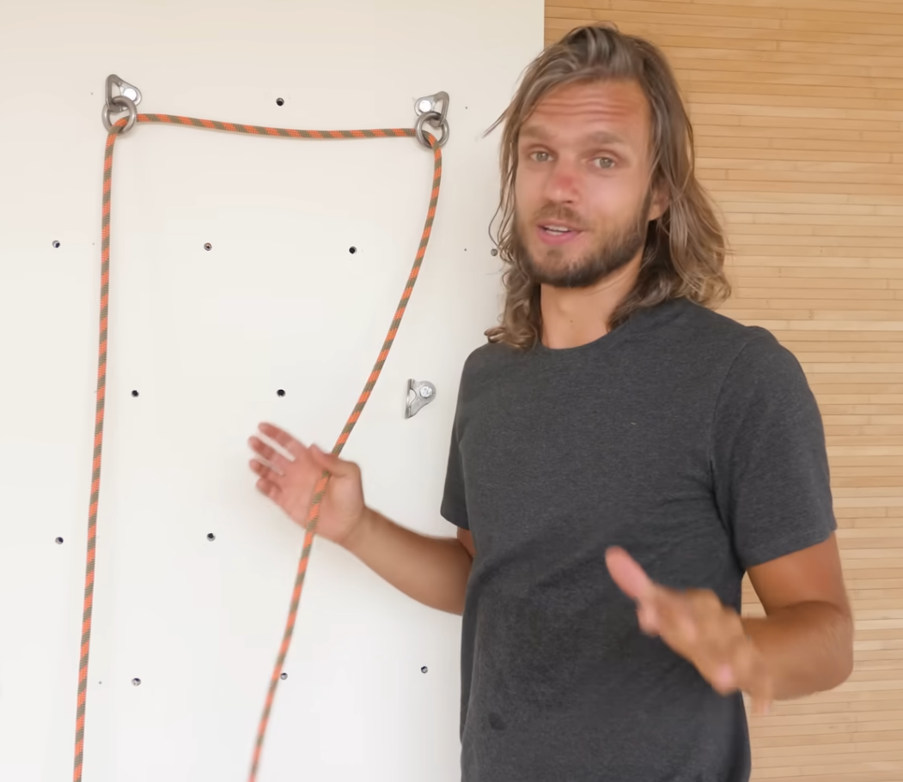

# Rope Twist Science

Of interest to people belaying with HMS and figure-eight rappeling devices.

## What is rope twist?

Rope twist is simply a number of turns in a length of a rope.

Rope twist is no mysterious, invisible property of the rope which causes it to tangle. It has nothing to do with core fibers twisting inside the sheath.

## Introduction

There are many misconceptions about why and how ropes twist.

HardIsEasy - Why do ropes twist? - https://youtu.be/ncUGR2JbefY?si=A7TzVIr18Ey3FZUf&t=1727
 
 - says tight radius twists ropes
 - says double anchor twists rope, but does not elaborate

 

Edelrid - Why ropes kink? - https://youtu.be/4AaX0wGrDxg?si=lrDea7-mz0yP27Fy&t=180

 - caused by ropes running obliquely through climbing anchors

## Types of rope twist

- Caused by incorrectly coiling ropes
- Caused by running climbing anchors
  - Double anchors
- Caused by belay devices
  - Lowering off of a HMS, or rapelling with a figure-eight

## Derivation

Climbing ropes are very resistant to torsion, because of their diagonally oriented sheath fibers. Following any curve, they will assume a torsion-free configuration.

### Helical twist

We will examine the case of helical twist, which can be used to approximate real world scenarios, like rope running through a ring at an angle. We will assume perfect friction, and perfect resistance to torsion.

Using notation and computations from this reference: https://rotations.berkeley.edu/kinematics-of-rods/

$ v_3 = 0 = \tau + \frac{\partial\phi}{\partial s} $

$ \tau = -\frac{\partial\phi}{\partial s} $

From (31), for a helix we have 

$ \tau = \frac{1}{r} \cos\beta \sin\beta $

$ -\frac{\partial\phi}{\partial s} = \frac{1}{r} \cos\beta \sin\beta $

where $ \beta $ is the angle between the rope and the axis of the helix, and $ r $ is the radius of the helix.

When unspooling the spirally wound rope, the speed with which it will twist, $v$, is given by:

$ v = \left| \frac{\partial\phi}{\partial s} \right| $

$ v = \frac{1}{r} \cos\beta \sin\beta $

#### Example

For a 10mm rope wound around a 10mm rod at the angle of 45 degrees, the twist velocity is:

$ v = \frac{1}{5+5} \cos(45^\circ) \sin(45^\circ) = \frac{1}{10} \frac{1}{2} = \frac{1}{20} \frac{rad}{mm} \approx 12 \frac{cm}{rev} $

So the rod will impart one full twist per 12 cm of rope length.

### Multiple helical twists in series

Rope segment has two properties:

1. Rope rotation rate $v_r$ - Apparent rotation of a line marked along the rope's length
2. Rope twist rate $v_t$ - rate of twist of the rope around its own axis

If rope is running through multiple devices imparting different twist velocities (approximated by the helical formula above), we make the following assumptions:

- The rotation rate of the whole rope $v_r$ equals the twist velocity of the first device it passes through, $v$.
- The twist rate of every segment $v_t$ stabilizes at $v_t = v_r - v$, where $v$ refers to the device following the segment.
- The outgoing segment twists if it is forced to do so by something following it. If not, it just rotates freely.

#### Example

Rope is running through two quick links, first one twists at 1 rev/m, the second twists at 3 rev/m. Rope is not pre-twisted, so $v_t = 0$ for the first segment.

Rope is divided into three segments by the quick links: segment before entering the first quick link, segment between the quick links, and segment after exiting the second quick link.

For all segments, $v_r = 1 \frac{rev}{m}$.

Segment 1:
- $v_{t1} = 0$ - rope is not pre-twisted

Segment 2:
- $v_{t2} = v_r - v_2 = 1 \frac{rev}{m} - 3 \frac{rev}{m} = -2 \frac{rev}{m}$

Segment 3:
- $v_{t3} = 0$, if nothing constrais rotation

So the system will twist the rope at the velocity determined by the first quick link - 1 rev/m. But between the quick links, the rope will twist in the opposite direction! - at 2 rev/m.

## Limitations

- When rope is twisted severely, or if it is not tensioned tightly, it may deform and choose the path of travel which untwists it. This effect will lessen the twisting effect of any devices placed along its path.
  - This mostly explains why tensioned ropes twist worse than slack ropes.
- Steady state is achieved only when all the requisite twists are balanced. Before that, ingoing rope rotation will not match the outgoing rope rotation.