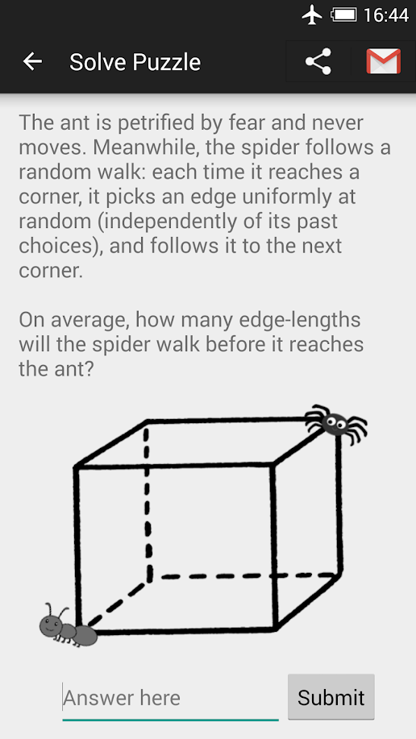
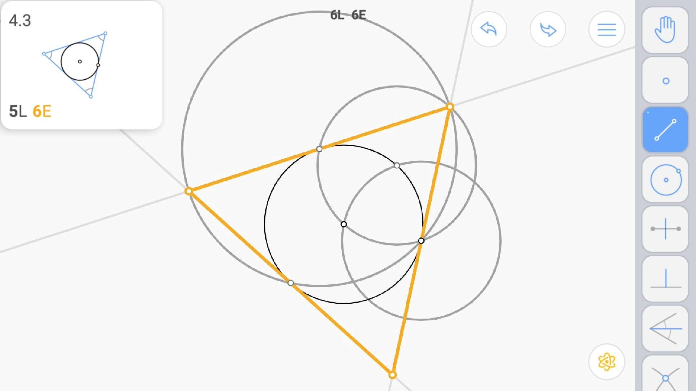
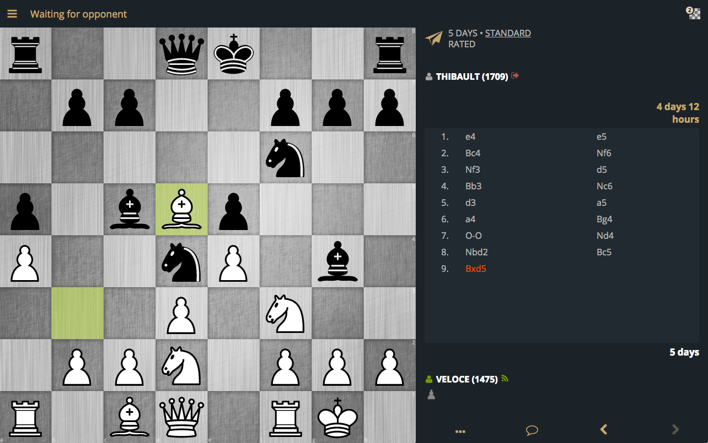
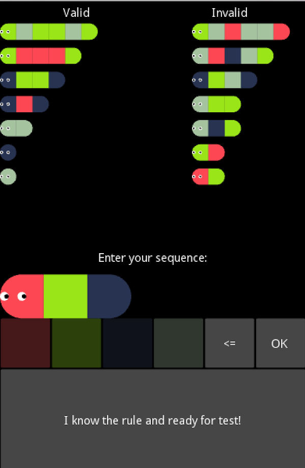
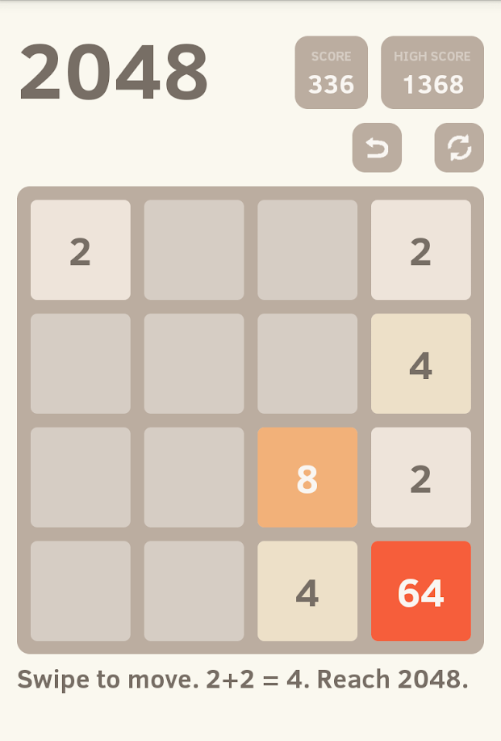

# Truly Challenging Logical Games for Android

I'm sure many people struggle to find challenging games for mobile platforms.
Most popular games' target audience is children, and most are made to be accessible to
anybody. This makes them very uninteresting for people that want some real mental
challenge.

Here's a list of Android games that were able to really test my logical thinking.

## 1. Probability Math Puzzles

[Probability Math Puzzles](https://play.google.com/store/apps/details?id=atorch.statspuzzles)
is what it says: a collection of puzzles focusing on probability theory. Each puzzle
is a math problem, and the solution is a number (or an expression evaluating to a number).
There are over eighty puzzles in total, sorted by difficulty, that can be solved in
any order you wish. They range from easy puzzles that can be solved by logic alone
to difficult problems that probably require some background in probability theory.
If a problem isn't difficult enough, you can try doing all the arithmetic in your head.
The app is simple but well-done, the puzzles are intriguing, error-free and some are
nicely illustrated.

Despite its simplicity, this is probably the most enjoyable game I found on mobile to date.
The only drawback is the number of puzzles. The author adds new ones over time though,
so make sure to check back every now and then after finishing the game.

## 2. Euclidea

[Euclidea](https://play.google.com/store/apps/details?id=com.hil_hk.euclidea)
offers a list of euclidean construction problems. Using only a ruler and a
straightedge, a player is challenged to construct shapes, angles, and other
elements with given properties. Not only that, the goal is to use the lowest
amount of steps, and to construct all possible elements. After doing certain
basic construction (such as an angle bisector), they can be used as a single
operation.

Puzzles are organized into 15 groups, which must be solved sequentially. In a free
version, a new group is unlocked by solving *all* the problems from previous groups
perfectly (in the least amount of steps, and finding all solutions). This may be
very difficult to do. Answers to puzzles can be found on the internet, or a full
version may be purchased, which enables a player to solve problems in any order.

The app is extremely well-done, efficient constructions are often non-obvious and
intriguing. Though I didn't finish the game yet, I can only recommend it.

## 3. Chess

Chess is hard. There are many chess apps, but I can recommend Lichess in particular.
Lichess is a good [Android app](https://play.google.com/store/apps/details?id=org.lichess.mobileapp),
and a truly amazing [web site](https://lichess.org/). Good tactical puzzles are available,
as well as normal games and tournaments. Many chess variants and time controls are supported.
Stockfish engine, game databases, and endgame tablebases can be used for game analysis.
Matches can be spectated, and many pro players play on Lichess regularly as of 2018 (including
Magnus Carlsen).

The whole thing is free (and open-source) with no ads, which is honestly
incredible given the amount of work and infrastucture that was necessary to make it all work.
Donations are welcome.

## 4. Caterpillar Logic

[Caterpillar Logic](https://play.google.com/store/apps/details?id=org.gromozeka1980.caterpillar_logic)
presents you with colored caterpillars split into two categories
according to an unknown rule. The task is to figure out the rule
by creating new caterpillars and watching which category they end up in.
The correctness of the inferred rule is checked by presenting player with
several caterpillars that must all be correctly categorized. There is a total
of 20 rules, increasingly complex, which can be solved in any order.

Caterpillar Logic is a much easier and shorter game than the three described
above. I think the concept has more potential than was
utilized - there could have been more rules, and they could have been more
complex. Nevertheless, the game is definitely worth checking out.

## 4. 2048

The classic game of
[2048](https://play.google.com/store/apps/details?id=com.tpcstld.twozerogame)
had me hooked for a while. The process of improving from ~256 to reliable
2048 and beyond is very rewarding. There are several strategies of increasing
difficulty but increasing reliability that are fun to figure out. After
mastering the basics, trying to recover from bad positions can provide more
mental challenge.

There is certainly much room to improve beyond the 2048 tile:
[an expectimax algorithm](https://stackoverflow.com/questions/22342854/what-is-the-optimal-algorithm-for-the-game-2048)
can get a 16384 tile 94% of the time! I think never got to 8192 though, because
the whole thing becomes a grind after a certain point.

## Conclusion

That's right, I found only like five good logical games for Android up to date.
If you know about any others, don't hesitate and contact me by a message or an
issue on GitHub.
